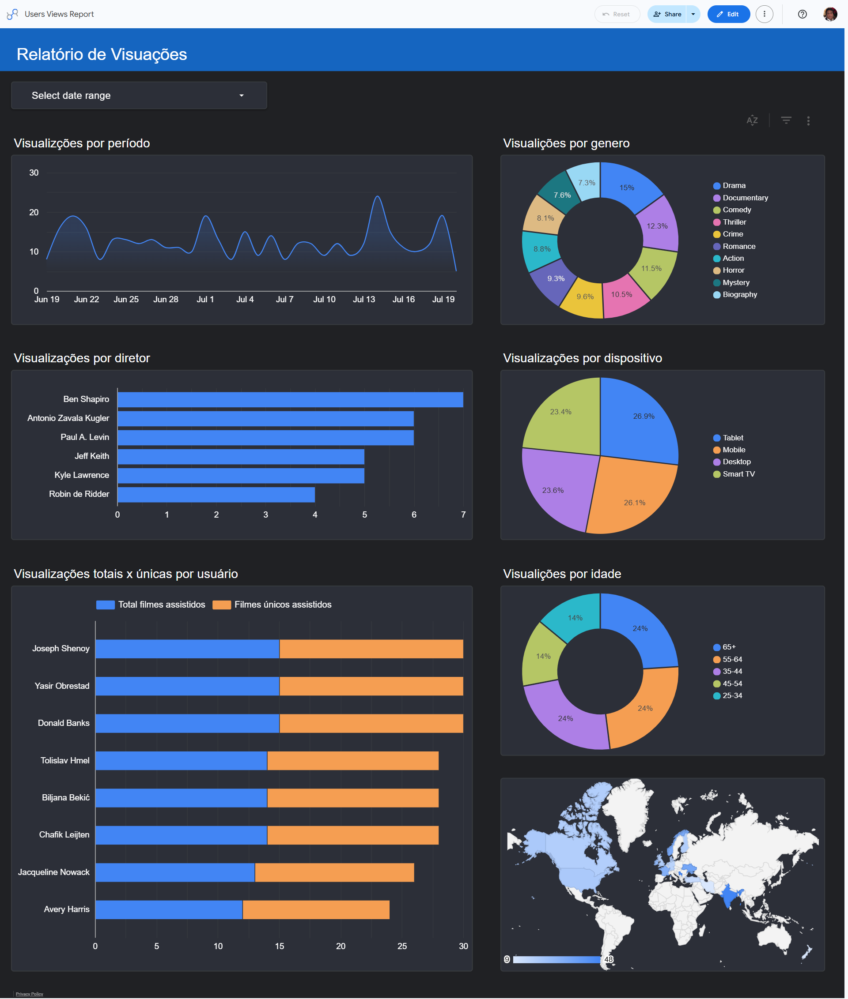

# Movie Views Dashboard

Pipeline ETL construído com **Apache Airflow** (Astro Runtime) para processar dados de visualização de filmes, carregá-los em dois bancos **PostgreSQL** (local + Render) e disponibilizar views analíticas para dashboards.

## Visão Geral

O projeto simula um cenário real de streaming: usuários assistem filmes, interagem (curtem, avaliam, adicionam à lista), e esses eventos são registrados. O pipeline ETL orquestrado pelo Airflow:

[Artigo completo sobre o projeto](https://www.reulison.com.br/blog/data-analytics/et-pipeline-postgresql-airflow "Pipeline ETL de Visualização de Filmes")

1. **Cria as tabelas** dimensionais (`dim_users`, `dim_movies`) e a fato (`fact_views`) no PostgreSQL
2. **Carrega os dados** de usuários, catálogo de filmes e eventos de visualização a partir de arquivos JSON
3. **Cria views analíticas** para consultas prontas para dashboard (`vw_user_kpi`, `vw_genre_analysis`, `vw_daily_views`, `vw_device_analysis`, `vw_movie_popularity`, `vw_user_sessions`, `vw_age_range_analysis`)

## Estrutura do Projeto

```
.
├── dags/
│   └── movie_views_etl.py        # DAG principal do Airflow
├── include/
│   ├── data/                     # Dados de entrada (JSON)
│   │   ├── users.json
│   │   ├── movie_catalog.json
│   │   └── views.json
│   └── sql/
│       ├── create_tables.sql     # DDL das tabelas
│       └── create_views.sql      # DDL das views analíticas
├── tests/                        # Testes automatizados
├── .devcontainer/
│   └── devcontainer.json         # Configuração do Dev Container
├── Dockerfile                    # Imagem Astro Runtime
├── requirements.txt              # Dependências Python
├── packages.txt                  # Pacotes OS (se necessário)
├── plugins/                      # Plugins customizados
├── airflow_settings.yaml         # Config local de conexões/variáveis
├── .env                          # Variáveis de ambiente (ignorado pelo git)
├── .gitignore
└── .dockerignore
```

## Tecnologias

- **Apache Airflow** (Astro Runtime 3.3)
- **PostgreSQL** (banco de dados relacional)
- **Python** (TaskFlow API, Pandas)
- **Docker** (containers para Airflow + PostgreSQL)
- **VS Code Dev Containers** (ambiente de desenvolvimento isolado)

## Como Executar Localmente

### Pré-requisitos

- [Astronomer CLI](https://www.astronomer.io/docs/astro/cli/install-cli) (`astro`)
- Docker Desktop

### Comandos

```bash
# Iniciar o ambiente Airflow
astro dev start

# Acessar a UI do Airflow
# http://localhost:8080

# Parar o ambiente
astro dev stop

# Destruir os containers (dados são perdidos)
astro dev kill
```

### Configuração do Banco

O pipeline escreve em **dois bancos PostgreSQL simultaneamente**:

| Conexão | Host | Banco | Finalidade |
|---------|------|-------|------------|
| `postgres_default` | `host.docker.internal:5432` | `postgres` | Local (iniciado pelo `astro dev start`) |
| `postgres_render` | `dpg-d9fokfnavr4c73cmqeg0-a.virginia-postgres.render.com:5432` | `moviedata_4nln` | Render (instância remota gerenciada) |

As conexões são configuradas no `airflow_settings.yaml` ou via variáveis de ambiente (`AIRFLOW_CONN_POSTGRES_DEFAULT` e `AIRFLOW_CONN_POSTGRES_RENDER`) no `.env`.

> **Por que dois bancos?** O plano gratuito do Render.com apaga bancos PostgreSQL após 90 dias. Como este é apenas um projeto de estudo, não quero ter gastos em dólar com planos pagos. A solução é manter o banco local como fonte persistente e usar o Render apenas enquanto ele estiver disponível gratuitamente. Quando o banco do Render for removido, os dados continuam seguros no banco local e posso recriar a instância remota sem perder histórico.

### Executando a DAG

Na UI do Airflow, ative a DAG `movie_views_etl` e clique em **Play** (execução manual). O pipeline completo:

1. Cria as tabelas `dim_users`, `dim_movies` e `fact_views` em ambos os bancos
2. Carrega dados de usuários em ambos os bancos
3. Carrega dados do catálogo de filmes em ambos os bancos
4. Carrega dados de visualizações em ambos os bancos
5. Cria/atualiza as 7 views analíticas em ambos os bancos

## Desenvolvimento com VS Code

Este projeto inclui configuração para [Dev Containers](https://code.visualstudio.com/docs/devcontainers/containers), permitindo desenvolver em um ambiente isolado com todas as dependências pré-instaladas.

### Pré-requisitos

- [VS Code](https://code.visualstudio.com/)
- [Dev Containers](https://marketplace.visualstudio.com/items?itemName=ms-vscode-remote.remote-containers) (extensão)
- [Astronomer CLI](https://www.astronomer.io/docs/astro/cli/install-cli) (`astro`)

### Como usar

1. Abra a pasta do projeto no VS Code
2. Clique no ícone verde no canto inferior esquerdo (`><`)
3. Selecione **Reopen in Container**
4. O container será buildado a partir da imagem Astro Runtime com as extensões Python, Docker e Astro instaladas
5. Após a inicialização, as dependências do `requirements.txt` e a Astro CLI serão instaladas automaticamente
6. Execute `astro dev start` no terminal integrado para iniciar o Airflow localmente

> O Dev Container usa Docker-in-Docker, permitindo executar `astro dev start` diretamente no terminal integrado sem depender do socket Docker do host.

## Views Analíticas Disponíveis

| View | Descrição |
|------|-----------|
| `vw_user_kpi` | KPIs por usuário (total filmes, tempo médio, progresso, curtidas, dias ativos) |
| `vw_genre_analysis` | Análise por gênero de filme por usuário |
| `vw_daily_views` | Tendência diária de visualizações |
| `vw_device_analysis` | Métricas por dispositivo / plataforma / navegador |
| `vw_movie_popularity` | Popularidade dos filmes (visualizações, likes, progresso médio) |
| `vw_user_sessions` | Sessões de visualização por usuário |
| `vw_age_range_analysis` | Visualizações agregadas por faixa etária |

## Licença

Este projeto é fornecido apenas para fins educacionais e de demonstração. Integração com Dashboard Loooker Studio abaixo.


